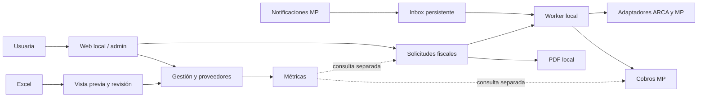

# Arquitectura

Python 3.11, FastAPI, SQLAlchemy 2.0, Jinja2, PostgreSQL 17.8 y Docker Compose.
Monolito modular: una aplicación y un worker del mismo proceso, sin broker, SPA,
frontend compilado ni framework adicional. La base coordina transacciones y trabajo
durable. Servicios de negocio sin HTML; rutas presentan resultados y validan acceso.

## Responsabilidades
| Área | Archivos principales | Datos y garantías |
| --- | --- | --- |
| Web | api/, web.py, templates/, assets/ | Sesión, CSRF, filtros, confirmaciones, paginación SQL y mensajes. |
| Facturación | services/billing.py, fiscal_gateway.py, arca/ | Solicitud, snapshot, reserva exclusiva y bloqueo por punto/tipo. |
| Comprobantes | services/invoices.py | ReportLab local, QR dinámico, total exacto 50/50, sin reemisión. |
| MP | services/mp.py, mp_inbox.py, payments.py | Inbox antes de ACK, GET canónico con timeout, identidad externa e historial. |
| Gestión | services/business.py | Ventas manuales independientes, egresos En Blanco/En Negro y proveedores. |
| Sueldos/Fiados | services/registers.py, api/registers.py | Registros simples, ENUM nativos, UUID/versión y CSRF; Fiados independiente. |
| Excel | services/excel_reader.py, excel_import.py | Lectura acotada, originales, decisiones, identidad por origen y conciliación. |
| Reportes | services/metrics.py | SQL/Decimal, datos vigentes, fuentes separadas y gráficos SVG. |
| Configuración | services/settings.py, access.py | Roles, sesiones revocables, límites/emisor versionados. |

## Flujos fiscales
La web prepara una confirmación con sesión de navegador, IDs estables, cantidad, importe,
versión de ajustes y vencimiento. TODO resuelve todo el filtro en el servidor;
seleccionados revalida cada ID. Confirmar crea una solicitud durable y devuelve
rápidamente su página de estado. El worker procesa después, fuera de HTTP.

Antes de emitir se guardan snapshot, reservas, solicitud, número y payload. Un
bloqueo de sesión PostgreSQL por punto/tipo se conserva entre commits y llamadas,
y se libera antes de devolver la conexión al pool. La configuración se coordina
con un bloqueo compartido/exclusivo. El worker revalida pagos por posibles devoluciones.

Estados principales: queued → sending → authorized / rejected / uncertain.
prepared conserva intentos que no pudieron enviarse; check_queued y retry_queued
guardan acciones de recuperación. Un sending sin proceso dueño pasa a consulta;
no se reenvía automáticamente. Una incertidumbre bloquea otra emisión del mismo punto.
Consultar exige coincidencia de punto/tipo/número/fecha/documento/moneda/importe.
Solo ausencia inequívoca habilita reintento explícito del MISMO payload y número.

Factura, raw_afip_response, vínculos, todas las marcas facturado y resultado se
confirman juntos. Un CAE seguido de fallo DB/ACK no autoriza otra factura: se recupera
la operación original. La idempotencia vive en DB, no en un botón deshabilitado.
El PDF se genera de la factura y su snapshot inmutable, sin contactar al proveedor.
Los históricos incompletos se identifican y no se rellenan con información inventada.

El adaptador afip.py conserva respuestas estructuradas, con conexión 5s/lectura 45s,
sin redirecciones ni reintentos POST automáticos. Usa certificados ya instalados;
se retiraron automatizaciones de creación de certificados y seeds antiguos.

## MP y worker
POST firmado o entrada legacy validada confirma primero el inbox. Una clave de
evento evita entregas idénticas; el ID canónico de pago evita duplicación de efectos.
El worker toma filas con SKIP LOCKED, lee el proveedor y actualiza pago/historial de
forma atómica, con orden por timestamp. Fallos se conservan y reintentan con espera.
El procesamiento MP no importa ni invoca servicios fiscales. Worker fiscal y MP
comparten hilo con prioridades acotadas, sin sumar infraestructura.
Los contratos efectivos y sus límites están en MERCADO_PAGO.md.

## Gestión y originales
BusinessEntry conserva cierres independientes de pagos/facturas. day_closing.py
consulta solo la DB para sugerir MP aprobado sin facturar de la fecha; la usuaria
puede modificarlo. business.py valida efectivo/MP y calcula la suma en servidor; no se impone igualdad con otras fuentes. UUID de formulario, venta
vigente única por fecha y bloqueo/versión en ediciones sin historial.
Las anulaciones heredadas siguen excluidas; se pueden archivar proveedores. Proveedores sin stock ni cuenta corriente.
Importación confirma filas listas, conserva ambiguas y mantiene ambos históricos
del dashboard fuera de gestión. Ver GESTION.md e IMPORTACION_EXCEL.md.

## Esquema
Las revisiones publicadas permanecen inmutables. El arranque comprueba head, sin
create_all ni migración automática productiva. Desarrollo/test migran explícitamente
antes del arranque. Baseline congelado independiente del ORM para adoptar el esquema
original sin recrearlo. La exportación Adminer contiene estructura y no datos.

| Revisión | Cambio |
| --- | --- |
| 0001_legacy | Cinco tablas originales, metadatos/exportación congelados. |
| 0002_cleanup | Campos de resolución, logs_invoice y payments.id_arca, con rechazo si contienen información. resolution_by no existía. |
| 0003_billing | Solicitudes, reservas y proveedor simulado persistente. |
| 0004_mp | Auditoría de duplicados antes de unicidad, inbox e historial. |
| 0005_settings | Acceso, configuración, auditoría y confirmaciones. |
| 0006_listings | Índices de listados y cola. |
| 0007_business | Gestión, proveedores y Float → NUMERIC con original y conciliación por fila. |
| 0008_import | Lotes/orígenes/celdas y decisiones del Excel. |
| 0009_reports | Índices de agregación por período. |
| 0010_simple_business | Egresos white/black, retiro de campos/historiales, sesiones anónimas y propietario de confirmaciones. |
| 0011_sales_payroll_credits | Desglose nullable de ventas, ENUM de empleados/medios, Sueldos y Fiados; sin alterar totales previos. |

Se conserva payments.bill por compatibilidad histórica; la elegibilidad usa estado,
registered_arca, reservas y vínculos. Otros campos históricos no se eliminan por
falta de escritura reciente. invoices.raw_afip_response queda poblado para nuevas
autorizaciones; no se inventan respuestas previas. Los importes usan NUMERIC(18,2).

## Entornos y acceso
Dev/test solo aceptan mock. Producción exige ENV=production, modo production y
ALLOW_LIVE_OPERATIONS=true. .env no se descubre automáticamente; APP_ENV_FILE debe
ser explícito. Ningún import, seed o arranque llama a proveedores.

API/DB de pruebas están en red interna, sin secretos ni certificados. Solo el proxy
dev expone 127.0.0.1:8001; no sirve de proxy genérico. Suite x86 y ARM usan proyectos
distintos y DB descartables. La simulación persiste comprobantes propios identificados
SIM/SIN VALIDEZ FISCAL y permite probar pérdida de respuestas y reinicios.

Sesiones opacas hasheadas, expiración, roles y CSRF; Facturación, Gestión, Resumen, Sueldos y Fiados
permiten uso anónimo; las demás secciones requieren admin. Health/assets públicos; webhooks usan su propio contrato. CSP sin
CDN ni scripts inline, límites de cuerpo y carga XLSX, salidas HTML escapadas y
errores sin SQL/credenciales. CSS/JS versionados evitan estilos antiguos al actualizar.
No se agregan exportadores de telemetría ni servicios externos de observabilidad.
Dependencias directas en requirements.in y resolución fijada en requirements.txt;
se conserva SQLAlchemy 2.0 y se eliminan pymysql/SDK MP que ya no se utilizan.

Los sueldos se agregan por fecha/empleado en metrics.py y reducen Ganancia una sola
vez; no se insertan también en business_entries. customer_credits es independiente:
marcar pagado no produce movimientos. Excel añade hojas de desglose y sueldos sin
alterar las seis columnas originales. No hay nuevas dependencias/procesos/servicios.
