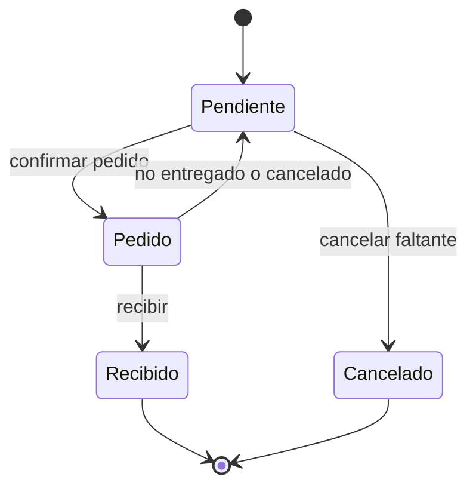

# Faltantes y pedidos a proveedores

Faltantes está debajo de Fiados en el menú de ARCA DYS. Usa la sesión local y la
protección CSRF de los demás formularios. La lista es compartida entre dispositivos.

## Uso diario

1. En **Faltantes**, escribí el nombre o código de barras y seleccioná el producto
   en las sugerencias. Si ya está en un pedido vas a ver **Ya pedido**. Pulsá
   **Registrar faltante**. Si no hay coincidencias, podés crearlo desde la
   búsqueda. Desde la tarjeta se puede editar cantidad u observaciones, o pulsar
   **Eliminar** para pasar el faltante a Cancelados.
2. Usá **Sin proveedor asociado** para encontrar faltantes sin un proveedor activo.
   Abrí **Gestionar proveedores** para completar los vínculos. En **Productos**
   podés buscar, editar y archivar fichas. Desde **Productos
   por proveedor** o la ficha de Gestión podés seleccionar varias fichas de la
   página y asociarlas juntas. La preferencia solo orienta la compra.
3. En **Pedidos**, escribí el proveedor y elegilo en las sugerencias para cargar
   sus faltantes automáticamente. Seleccioná los productos. Ajustá cantidades
   y observaciones y revisá el mensaje. Podés copiarlo o abrir WhatsApp si el
   contacto de Gestión contiene un número único en un formato reconocible. Una
   vez hecho el pedido, pulsá **Registrar pedido realizado**. Copiar y abrir el
   enlace son acciones de consulta.
4. En **Historial**, abrí el pedido para recibir todo o resolver cada renglón.
   **Mantener pendiente de entrega** conserva el pedido abierto. **No entregado**
   y **Cancelar** devuelven ese producto a Faltantes y guardan el resultado de
   ese intento. Podés anotar observaciones incluso si el renglón sigue abierto.

Los filtros de productos y proveedores usan sugerencias al escribir. Los cambios
de estado, fecha y otros filtros de pocas opciones actualizan el reporte al
seleccionarlos. **Buscar** aplica el texto libre y **Limpiar** restablece los
valores iniciales. La unidad, la presentación y la descripción se conservan en
los datos de origen e históricos y se omiten en las pantallas y el mensaje.

El contacto de WhatsApp admite un número internacional explícito con `+`, el
formato `549` más código de área y número, o un celular argentino de diez
dígitos. Con un contacto libre ambiguo se ofrece copiar el texto. La vista
permite seleccionar el texto manualmente si el navegador restringe el portapapeles.
La aplicación conserva un borrador con cambios al pasar a WhatsApp y comprueba las
versiones al registrar. La coordinación del envío manual ocurre fuera del sistema.

## Datos y garantías

La revisión [`0022_restock`](../migrations/versions/0022_restock.py) agrega seis
tablas. [`0023_restock_catalog`](../migrations/versions/0023_restock_catalog.py)
agrega los estados de origen, las marcas de sincronización y la descripción de
catálogo en los renglones nuevos de pedido. Las rutas HTTP y plantillas viven en `app/api/restock.py` y
`app/templates/restock/`. `app/services/restock.py` concentra las reglas y
consultas. El módulo conserva la arquitectura FastAPI, Jinja y SQLAlchemy.

| Tabla | Datos y relaciones |
| --- | --- |
| `restock_products` | Ficha local e ID estable, presentación y código de barras. Identidad comercial opcional y única por `(source, external_id)`. |
| `restock_product_suppliers` | N:M con `suppliers`; clave primaria compuesta y hasta un preferido por producto. |
| `restock_needs` | Necesidad y datos estimados, fecha, estado y versión. Un índice parcial permite un solo faltante pendiente o pedido por producto. |
| `restock_orders` | Proveedor existente, nombre al registrar, UUID de confirmación, observaciones y fechas. |
| `restock_order_lines` | Resultado, cantidades, observaciones y datos de producto al registrar. Un índice parcial permite un solo renglón en espera por faltante. |
| `restock_catalog_sync` | Último intento, última sincronización exitosa y error por origen. |

Registrar un pedido bloquea y revalida proveedor, productos y faltantes
seleccionados antes de escribir. Si algún producto dejó de ser elegible o cambió
su versión, se rechaza el pedido entero y se actualiza la lista. El registro
y todos sus renglones se confirman en la misma transacción. Un reintento del
mismo formulario y contenido devuelve el pedido original. La recepción bloquea
el pedido y los faltantes afectados en una transacción. El estado de la cabecera
se calcula a partir de los renglones; la fecha de cierre se guarda cuando se
resuelve el último pendiente de entrega.

Archivar un proveedor conserva vínculos e historial y lo retira de los pedidos
nuevos. Un producto archivado o retirado del catálogo deja de admitir nuevos
faltantes. Los pendientes y pedidos existentes siguen accesibles con una
advertencia y pueden resolverse, incluso si hay que asociar otro proveedor.
Cambiar asociaciones, una presentación o el nombre de un producto o proveedor
conserva los datos de los pedidos ya registrados.

Se reutilizan los filtros parciales de reportes. Las vistas dinámicas se sirven
con `Cache-Control: no-store`. La PWA actual usa el manifiesto y abre en línea;
en el repositorio no hay un service worker que cachee respuestas. Al volver a la
página se consultan los listados, preservando formularios con cambios.

## Catálogo Dulce y Salado

Dulce y Salado es el origen de los productos comerciales. ARCA DYS usa una copia
local para sus búsquedas, relaciones y pedidos. Guardá bolsas, etiquetas y otros
insumos como productos locales desde **Nuevo producto**. El nombre es el único
dato obligatorio. Los nombres y códigos similares generan una advertencia;
las presentaciones siguen siendo fichas independientes.

`app/services/dys_catalog.py` consume la API v1 por `GET` y Bearer con la
paginación `after_id`. El ID original de Django se guarda como texto en
`external_id`, con `source=dulce-salado`. La presentación combina unidad comercial
y marca. Se conserva la descripción para distinguir variantes y el código de
barras se mantiene como texto, incluidos sus ceros iniciales. La ficha está
disponible cuando su estado local, su estado de origen y su categoría están activos.
El contrato está en `docs/INTEGRACION_ARCA_DYS.md` y `docs/arca-dys.openapi.yaml`
del repositorio Dulce-Salado.

**Productos → Catálogo Dulce y Salado** muestra la última sincronización exitosa,
la última conciliación completa y el error más reciente. **Sincronizar catálogo**
hace una lectura completa al inicio y al cumplirse siete días desde la última.
Entre conciliaciones utiliza `updated_since` inclusivo desde el inicio de la
última sincronización exitosa, con cinco minutos de solapamiento. **Conciliar
catálogo completo** permite adelantar ese barrido.

El servicio aplica toda la lectura en una transacción por identidad externa y
conserva las fichas locales y su archivado. Verifica una ficha ausente por ID
antes de marcarla retirada y vuelve a confirmar que el listado siga disponible.
Una página, un detalle o una credencial inválidos conservan la copia y la marca
anteriores. El catálogo en servicio puede seguir cambiando entre páginas; el
solapamiento y la reconciliación periódica permiten recuperar esos cambios.

La sincronización también se puede iniciar desde el contenedor ARCA con
`python -m app.manage sync-restock-catalog` y la opción `--full`. La ejecución es
manual. Para programarla conviene medir frecuencia de cambios y duración y usar
el mismo comando fuera del ciclo de la cola fiscal.

## Validación y recuperación

La suite Compose usa datos ficticios y PostgreSQL aislado. Incluye altas, cambios,
vínculos, filtros, duplicados, dos operaciones concurrentes, registro parcial de
pedidos, recepción, cancelación, historial, proyección local y rollback. El
perfil `backup-test` comprueba la restauración de un faltante activo, su proveedor
preferido y dos intentos de pedido, junto con las verificaciones anteriores.

El despliegue y la recuperación de esta revisión siguen el procedimiento específico
de [operación en Raspberry](OPERACION_RASPBERRY.md#faltantes-0022).
